<p align="center">
  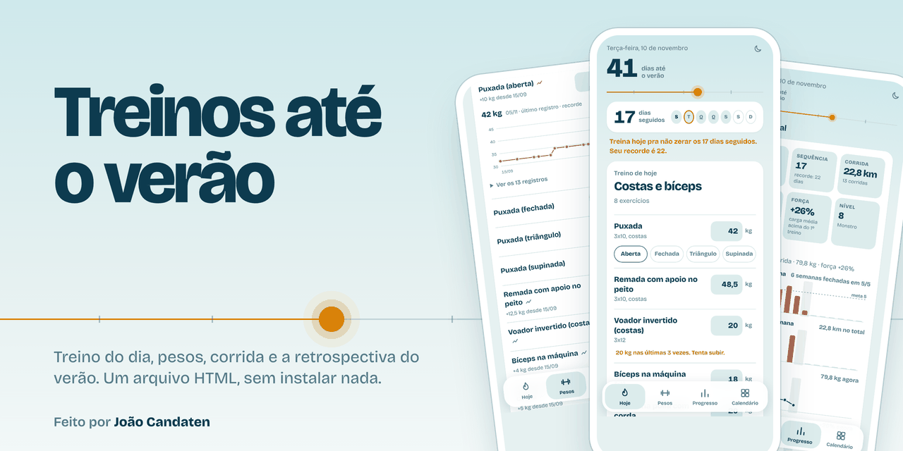
</p>

<p align="center">
  App de treino de uso pessoal para acompanhar academia e corrida até o verão.<br>
  Um único arquivo HTML que se instala no celular e funciona sem internet.
</p>

<p align="center">
  
  
  
  
</p>

<p align="center">
  <a href="https://joaoluizcfonseca.github.io/treinos-academia/"><b>Abrir o app</b></a> &nbsp;|&nbsp;
  <a href="#telas">Telas</a> &nbsp;|&nbsp;
  <a href="#funcionalidades">Funcionalidades</a> &nbsp;|&nbsp;
  <a href="#como-funciona">Como funciona</a> &nbsp;|&nbsp;
  <a href="#testes">Testes</a>
</p>

> [!NOTE]
> **Projeto de uso pessoal.** Este é o app que eu uso para registrar os meus treinos. Ele foi feito sob medida para a minha rotina (plano de treino, metas e feriados) e não é um produto: não tem contas, servidor nem suporte para outras pessoas. O código está público para consulta.

## Telas

| Hoje | Pesos | Progresso | Calendário |
|:---:|:---:|:---:|:---:|
| 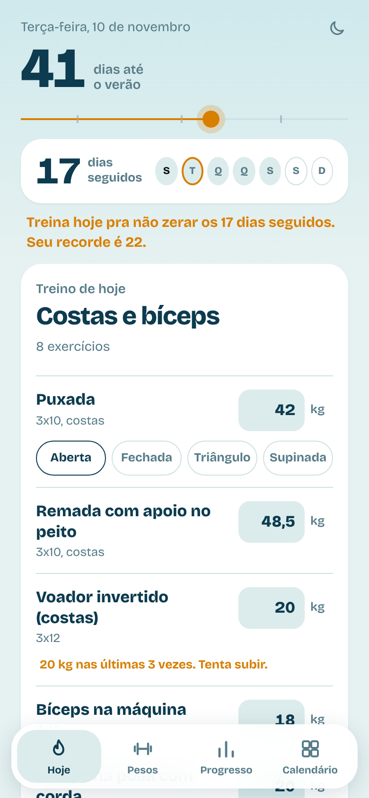 | 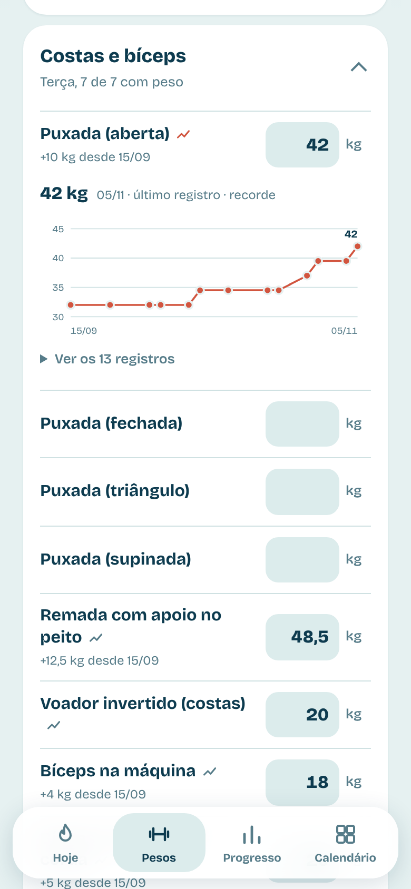 | 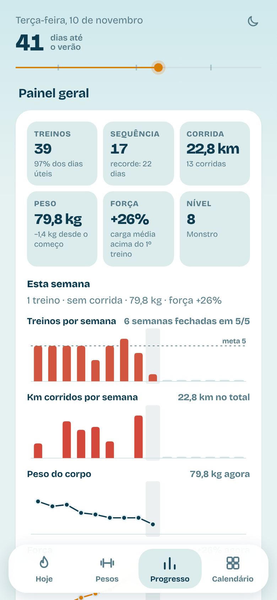 | 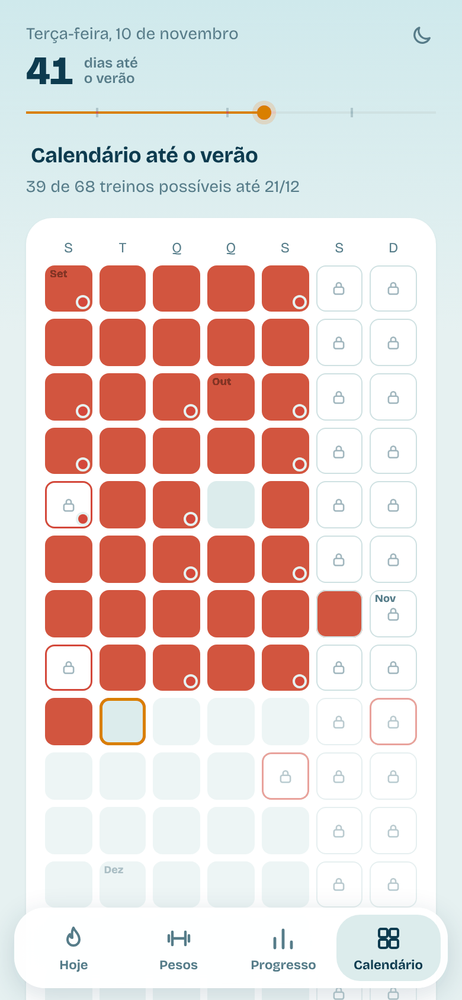 |

<p align="center"><sub>Telas com dados de exemplo, no visual padrão (Maré).</sub></p>

## Funcionalidades

### Treino

- **Treino do dia:** os exercícios com o peso da última vez já preenchido. Um toque em *Terminei o treino* registra tudo, sem marcar série por série.
- **Pesos por exercício:** histórico, recordes e gráfico de evolução. A puxada guarda um peso para cada pegada.
- **Sugestão de carga:** quando o peso de um exercício se repete três vezes seguidas, o app sugere subir.
- **Treinos esquecidos:** dias da semana sem registro aparecem no topo, com o treino mais provável, para marcar com um toque.
- **Primeira barra fixa:** o tempo pendurado na barra entra em todos os treinos da semana, com meta e evolução até tentar a primeira barra.

### Progresso

- **Painel geral:** treinos, sequência, corrida, peso, força e nível, com gráficos semanais na mesma escala de tempo.
- **Detalhes:** evolução das cargas, séries por músculo, corridas (distância, tempo e ritmo) e peso corporal com a meta de proteína.
- **Calendário** até o verão, com feriados, para marcar ou corrigir qualquer dia.
- **Nível e conquistas**, incluindo conquistas secretas.

### Retrospectivas

- **Do verão:** no dia 21/12 ela abre sozinha, em histórias de tela cheia no estilo das retrospectivas dos apps de música: treinos, toneladas levantadas, treino favorito, evolução das cargas, corridas, maior sequência, nível e perfil de treino. Termina num cartão para compartilhar.
- **De cada mês:** uma por mês, com aviso nos primeiros dias do mês seguinte.

| Treinos | Treino favorito | Corridas | Resumo |
|:---:|:---:|:---:|:---:|
| 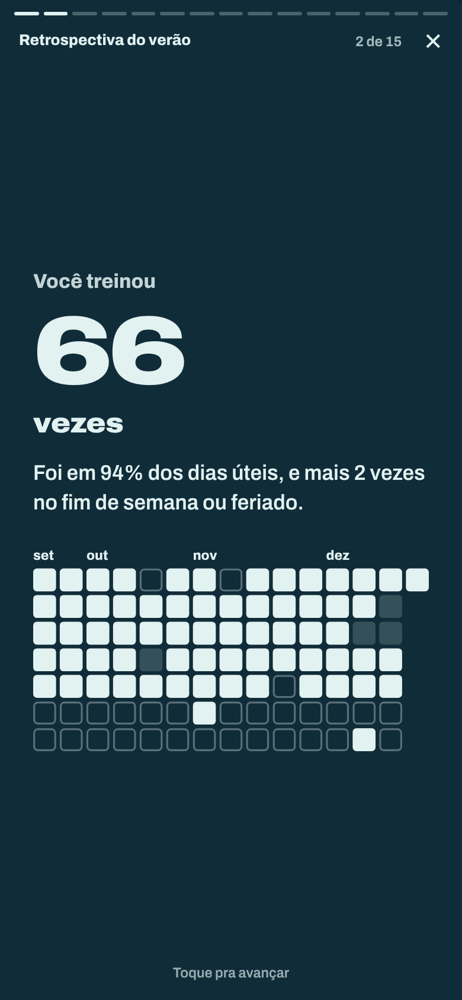 | 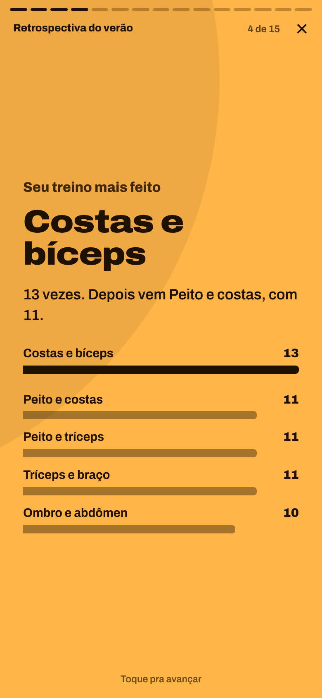 | 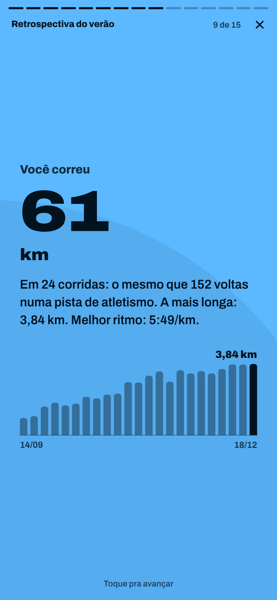 | 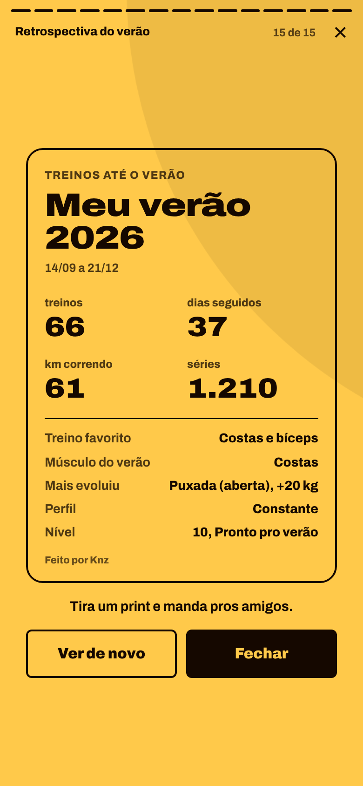 |

### Visuais

Quatro visuais, cada um com tema claro e escuro e a própria escala de cores por nível. A escolha fica salva no aparelho.

| Maré (padrão) | Anilha | Caderno | Original |
|:---:|:---:|:---:|:---:|
| 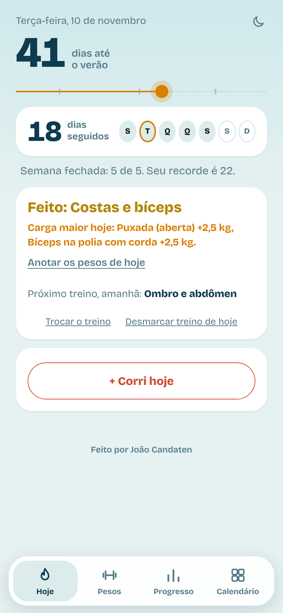 | 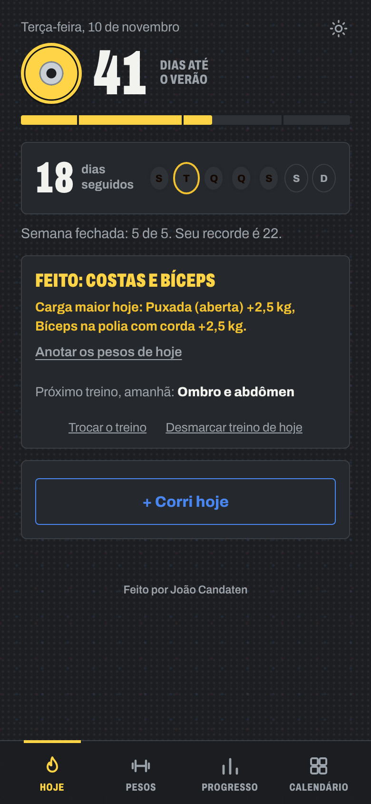 | 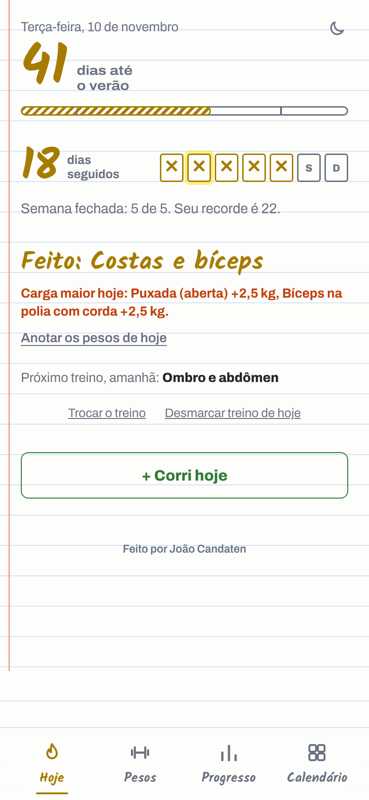 | 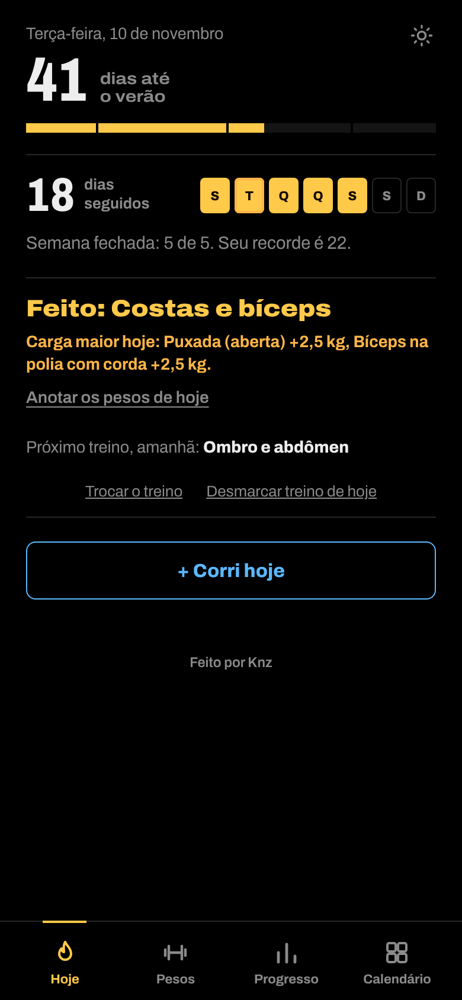 |

### Sem internet

Instalado na tela inicial, o app abre e salva sem conexão. Os dados ficam no aparelho, com exportação e importação de backup em **Progresso → Backup**.

## Como funciona

- **Um arquivo só.** O `index.html` contém o HTML, o CSS, o JavaScript e os dados, num JSON em `<script id="state">`. Não tem build, framework nem dependências.
- **App instalado (GitHub Pages).** Os dados ficam no `localStorage` do aparelho. O service worker (`sw.js`) guarda o app na primeira visita, abre a partir dele com ou sem sinal e baixa as atualizações em segundo plano.
- **No claude.ai.** O app publica uma nova versão de si mesmo a cada alteração, com os dados embutidos. Se a publicação falhar, nada trava: o que foi anotado fica no aparelho e é enviado no próximo toque.
- **Sem perda de dados.** Anotações feitas sobre uma versão antiga são mescladas na nova, e se o dia virar com o app aberto, ele espera terminar a digitação antes de atualizar a tela.

<details>
<summary><b>Formato dos dados</b></summary>

| Chave | Conteúdo |
|---|---|
| `logs` | dia → treino feito |
| `runs` | dia → `{km, min}` da corrida |
| `ex` | dia → treino escolhido e pegada da puxada |
| `loads` | exercício → `{dia: valor}` em kg (no tempo pendurado, em segundos) |
| `weight` | dia → peso corporal em kg |
| `hr`, `sec` | histórico usado no nível e nas conquistas |
| `supp`, `chal`, `flash`, `habits` | dados de funções antigas, apenas preservados |
| `rev` | versão dos dados, incrementada a cada salvamento |

</details>

### Estrutura do repositório

```
.
├── index.html             o app inteiro: HTML, CSS, JavaScript e dados
├── manifest.webmanifest   instalação na tela inicial (nome, ícone e cores)
├── sw.js                  service worker: funcionamento sem internet
├── icons/                 ícones do app
├── fonts/                 fontes do app (SIL Open Font License 1.1)
├── docs/                  imagens deste README
├── tests/                 testes de ponta a ponta (pytest + Playwright)
└── requirements-dev.txt   dependências dos testes
```

## Instalação

1. Abra **[joaoluizcfonseca.github.io/treinos-academia](https://joaoluizcfonseca.github.io/treinos-academia/)** no celular, com internet.
2. Instale na tela inicial:
   - **iPhone (Safari):** botão de compartilhar → **Adicionar à Tela de Início**.
   - **Android (Chrome):** menu **⋮** → **Instalar app**.
3. Para trazer dados de outro aparelho: **Progresso → Backup → Importar backup**.

No computador, basta abrir o `index.html` no navegador.

## Testes

São 95 testes de ponta a ponta com [pytest](https://pytest.org) e [Playwright](https://playwright.dev/python/), que abrem o app num navegador de verdade:

```bash
pip install -r requirements-dev.txt
playwright install chromium
pytest
```

Eles cobrem:

- **Treino:** do começo ao fim, com pesos, pegadas, sugestão de carga, treinos esquecidos e desmarcar sem deixar dados para trás.
- **Cálculos:** sequência, nível, séries por músculo, painel geral e evolução das cargas.
- **Retrospectivas:** verão inteiro simulado, prévia, retrospectiva de cada mês, navegação das histórias e o app depois do verão.
- **Visuais:** os quatro, nos dois temas, em telas a partir de 320 px, com contraste legível sobre a cor do nível.
- **Salvamento:** versões novas, conflitos, falhas de publicação e telas que não conseguem salvar, sem nunca travar os campos.
- **Sem internet:** abrir e salvar com o servidor desligado, fontes incluídas e backup de ida e volta.

## Licença

Projeto pessoal, sem licença de uso: todos os direitos reservados. As fontes em `fonts/` (Archivo, Bricolage Grotesque e Kalam) são distribuídas sob a [SIL Open Font License 1.1](fonts/OFL-Archivo.txt).

---

<p align="center">Feito por <b>Knz</b> 🇧🇷</p>
